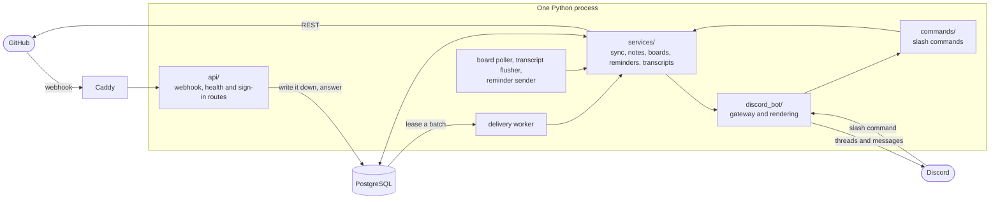

# How Shannon is built

This is a map of the code for somebody about to change it: what the parts are, how a GitHub event
becomes a Discord thread, why it is built this way, and what is still to do.

- [README.md](README.md) says what the bot does, every setting, every table and every route.
- [CONTRIBUTING.md](CONTRIBUTING.md) says how to set up, make a change, check it and propose it.
- [requirements.md](requirements.md) is the product spec: what the bot was asked to do.

The refactors planned in #239 and #266 to #273 will move things around. When they do, this file
moves with them.

## The whole thing in one picture



Everything runs in one process: the Discord bot, the FastAPI app and every background loop. Caddy
sits in front of it on a server, and PostgreSQL holds both the data and the queue of deliveries.

There are two ways in:

- **GitHub sends a webhook.** The route writes it down and answers straight away. A worker picks
  it up later and does the slow part.
- **A person runs a slash command.** The command calls the same services the worker does.

## Layers

### Where the code lives

Listed from the bottom layer up. A package only imports packages listed before it.

```text
shannon/
  config.py     settings, read from SHANNON_* variables. Imports nothing from the project
  domain/       enums, snapshots, errors, time and board rules. Imports nothing but the standard library
  db/           SQLAlchemy models, the engine and session, and stores/: the queries, mostly one
                store per table
  github/       the REST client, App sign-in and installation tokens, project boards, link parsing
    webhooks/   signature check, a parser per event, and the router that picks a handler
  discord_bot/  the bot client, the thread gateway, the permission gate, and turning a message
                into Discord components. Capturing messages for a logged conversation
  services/     what the bot does, one module per job:
    sync/       one item into its thread: policies, staleness, notifications, announcement lines
    delivery/   the queue and the worker that drains it
    reminders/  writing a reminder down, and sending it when it falls due
    transcripts/  logging a Discord conversation and publishing it to GitHub
    ...         boards, linking, verification (sign-in links), registration, reviews, notes and more
  api/          the FastAPI app and its routes: webhooks, health, OAuth sign-in
  commands/     the slash commands, which drive services the way the routes do
  runtime/      starting and stopping the process, and what /health reports
  container.py  the wiring: builds every long-lived object and hands each its parts
  main.py       builds the bot and the app, and hands them to uvicorn
```

`api/` and `commands/` sit side by side and never import each other. `commands/` is not inside
`discord_bot/` because it drives services for a person, which makes it a way in, like a route, not
an adapter.

### The import rule

The rule is kept by hand. No tool checks it today; #203 is a draft that proposes one. What does
hold it:

- `domain/` imports nothing outside itself, which is what lets the unit tests run with no database
  and no network.
- A test checks that `config.py` imports nothing from the project
  ([test_config_is_only_configuration.py](tests/unit/test_config_is_only_configuration.py)).
- Libraries stay in their layer. FastAPI is only used by `api/`, `runtime/` and `main.py`.
  discord.py is only imported by `discord_bot/` and `commands/`.
  No command imports SQLAlchemy.
- Where a lower layer needs something from a higher one, it is handed in. The bot is given its
  error translator (`reply_for` in [commands/_replies.py](shannon/commands/_replies.py)) instead of
  importing it.

### Wiring, protocols and stand-ins

[container.py](shannon/container.py) builds the long-lived objects: the GitHub clients, the
database engine and session factory, the services, the worker, the loops and the commands. Two
things come from elsewhere. [main.py](shannon/main.py) builds the Discord bot and its thread
gateway first and hands the gateway in, because the container needs a live Discord client. And at
startup the lifespan builds its own health probe. Services, stores and commands never build their
own collaborators: they are handed them. When two paths need the same service with different parts,
the container builds it twice, rather than adding a flag. For example, `/refresh` gets a sync
service built with no notifier, so it cannot ping anybody.

Anything that talks to Discord or GitHub sits behind a `typing.Protocol`. The two big ones are
declared next to the real adapter: `ThreadGateway` ([discord_bot/threads.py](shannon/discord_bot/threads.py))
and `GitHubClient` ([github/client.py](shannon/github/client.py)). Each is built from narrow roles,
and a caller names only the roles it uses, so a caller that only posts to a thread cannot also
rename one. A service that needs something smaller often declares its own small protocol in its
own module.

Tests swap the real classes for hand-written stand-ins in [tests/fakes/](tests/fakes/), not mocks.
`IMPLEMENTATIONS` in
[test_stand_ins_match_what_they_replace.py](tests/unit/test_stand_ins_match_what_they_replace.py)
lists stand-ins and real classes next to the protocols they implement, and checks that each one
listed still matches. Add a row when you add a stand-in. There are two exceptions:

- The real GitHub client (`HttpGitHubClient` in [github/client.py](shannon/github/client.py)), the
  sign-in flow ([services/verification.py](shannon/services/verification.py)) and the installation
  tokens call GitHub and Discord with a plain `httpx` client, which tests replace with
  `httpx.MockTransport`.
- `DiscordThreadGateway` itself is tested against mocks of discord.py objects
  ([tests/unit/discord_bot/test_threads.py](tests/unit/discord_bot/test_threads.py)).

## One webhook, from GitHub to a thread

The README has the short version in
[How a delivery becomes a thread](README.md#how-a-delivery-becomes-a-thread). This is where each
step lives.

1. **Check it.** `POST /webhooks/github` ([api/routes/webhooks.py](shannon/api/routes/webhooks.py))
   reads the body (25 MB at most) and checks its HMAC signature
   ([github/webhooks/signature.py](shannon/github/webhooks/signature.py)). A bad signature gets
   401. With no secret set, the route refuses everything with 500.
2. **Skip what does not matter.** The router ([github/webhooks/router.py](shannon/github/webhooks/router.py))
   says whether the bot acts on this event and action. If not, the answer is `ignored` and nothing
   is stored. The list is `SUPPORTED_EVENTS` in [events.py](shannon/github/webhooks/events.py).
3. **Write it down.** The delivery and its body go into `webhook_events`
   ([services/delivery/queue.py](shannon/services/delivery/queue.py)). A delivery id seen before
   answers `duplicate`, unless it had failed, in which case it is queued again so GitHub's
   Redeliver button works. A full connection pool answers 503, not 500.
4. **Lease it.** The worker ([services/delivery/worker.py](shannon/services/delivery/worker.py))
   takes up to 10 deliveries with `FOR UPDATE SKIP LOCKED` and handles them one at a time, oldest
   first, 60 seconds each at most. A failure is tried again after a growing wait, from 5 seconds
   up to 15 minutes, for 16 attempts in all: about two hours. A `PermanentError` is dropped at
   once.
5. **Parse it.** A parser in [github/webhooks/](shannon/github/webhooks/) turns the payload into a
   frozen snapshot from [domain/models.py](shannon/domain/models.py). The REST client makes the
   same snapshots, which is why a webhook and a command can share one sync service.
6. **Sync the item.** `ItemSyncService.sync` ([services/sync/items.py](shannon/services/sync/items.py))
   is the one path any item takes into Discord.
   - It holds a per-item lock in PostgreSQL ([one_at_a_time.py](shannon/services/sync/one_at_a_time.py)),
     so two writers of one item cannot interleave.
   - One transaction finds the repository and channel, updates the item and works out the message.
   - The item's high-water mark (`github_updated_at`) stops an old delivery undoing a newer one
     ([staleness.py](shannon/services/sync/staleness.py)).
   - Discord is only called after the transaction commits.
   - What differs between pull requests, issues and board cards lives in a policy
     ([policies.py](shannon/services/sync/policies.py)), not in `if` statements.
7. **Post once.** Anything that must not appear twice is claimed in the database before it is
   posted, and the claim is released if the post fails: pings in `item_assignments`
   ([notifications.py](shannon/services/sync/notifications.py)), and comments, reviews and
   announcement lines in `mirrored_notes` ([services/notes.py](shannon/services/notes.py),
   [announcements.py](shannon/services/sync/announcements.py)).
8. **Draw it.** A renderer in [formatting.py](shannon/discord_bot/formatting.py) returns a `Panel`
   ([panels.py](shannon/discord_bot/panels.py)), which knows nothing about discord.py.
   [layout.py](shannon/discord_bot/layout.py) turns it into Discord components. Text from GitHub is
   made safe first ([safe_text.py](shannon/discord_bot/safe_text.py),
   [rich_text.py](shannon/discord_bot/rich_text.py)), so it cannot ping anybody or hide a link.

A failure anywhere sends the whole delivery back to be tried again. That is why every step is safe
to repeat.

## One slash command

Take `/pr <link>` ([commands/sync_link.py](shannon/commands/sync_link.py)):

1. A shared guard ([commands/_guards.py](shannon/commands/_guards.py)) checks the command was run
   in a server, then asks the permission gate ([discord_bot/permissions.py](shannon/discord_bot/permissions.py))
   whether the member holds the tier the command needs. A tier is one of Admin, Project Manager,
   Reviewer and Developer, each matched to Discord roles by a setting. The tier each command needs
   is in [commands/_permissions.py](shannon/commands/_permissions.py). Commands that change things
   on GitHub also ask GitHub whether the member can write to the repository, but only for a member
   who has proved their GitHub account with `/link`. For a member who has not, the role alone
   decides, unless `SHANNON_REQUIRE_PROVED_LINKS` is on, which refuses them. If GitHub cannot be
   reached, the role decides ([services/access.py](shannon/services/access.py)). `/pr` does not
   ask.
2. The command calls a service. Here, `ManualSync` ([services/sync/manual.py](shannon/services/sync/manual.py))
   reads the item from GitHub's REST API and calls the same `ItemSyncService.sync` as the worker.
3. If anything raises, `reply_for` ([commands/_replies.py](shannon/commands/_replies.py)) turns the
   error into the reply the member sees.

## What else runs in the process

| Task | What it does | How often | If it dies |
| --- | --- | --- | --- |
| Discord gateway | The bot's connection to Discord | Always | The process stops, so it is restarted |
| Delivery worker | Works the webhook queue. Once an hour it also prunes old deliveries and spent sign-in links | Every 2 s when idle | The process stops, so it is restarted |
| Board poller ([services/projects.py](shannon/services/projects.py)) | Reads every linked project board and syncs card moves | Every 2 s, or every 60 s for all boards while any linked board is too big for one page | Logged, shown in `/health`, not restarted |
| Transcript flusher ([services/transcripts/flush.py](shannon/services/transcripts/flush.py)) | Publishes logged Discord conversations to GitHub as one comment per batch | Checks every 5 s | Logged, shown in `/health`, not restarted |
| Reminder sender ([services/reminders/send.py](shannon/services/reminders/send.py)) | Sends `/remind` reminders when they fall due | Checks every 5 s | Logged, shown in `/health`, not restarted |

Only the gateway and the worker stop the process when they die
([runtime/supervision.py](shannon/runtime/supervision.py)). Docker restarts on an exit, not on a
failing health check, so exiting is the only way to get a restart. The other three are reported by
[`/health`](README.md#http-surface) but do not fail it: webhooks still arrive and threads are still
written without them. What the flusher has not published or the sender has not sent waits in its
table, and a card move the poller missed is found the next time a poller reads the board.

### Starting and stopping

Startup, in [runtime/lifespan.py](shannon/runtime/lifespan.py):

1. Check that the database is reachable and has been migrated, within 15 seconds. If not, stop.
2. Load which threads are being logged, before any message can arrive.
3. Start the gateway, then the worker, the flusher, the poller (if enabled) and the reminder sender
   (if there is a Discord token).

The worker waits for the gateway before its first batch, because a delivery tried before Discord
connects only burns an attempt. It waits 5 minutes at most, then works the queue anyway.

Shutdown asks all four loops to stop, then gives each up to 5 seconds to finish what it holds
before cancelling it. The worker hands back the deliveries it has not started. Then the Discord
client, the HTTP clients and the database pool are closed. A step that fails is logged and the
next one still runs, and the database pool is always closed. The compose files give all this 50 seconds (`stop_grace_period`), and a test keeps
that number above the worst case.

## Data

- **Stores** in [db/stores/](shannon/db/stores/) hold the queries for a table. A store never
  commits: the service opens the transaction, builds the stores it needs on that session, and
  commits.
- **Snapshots** in [domain/models.py](shannon/domain/models.py) are frozen dataclasses. A webhook's
  payload is turned into a snapshot first, and the sync works on that. The few announcement lines
  that need a field the snapshot does not keep, such as which label moved, read it from the payload
  carried beside it.
- **Migrations** in [migrations/versions/](migrations/versions/) are numbered by hand (`0001` and
  on). They run as their own step before the app starts (the `migrate` service in
  [docker-compose.yml](docker-compose.yml)), so two copies of the app never race to apply them. A
  test checks that they build exactly what the models describe.
- **Enums are stored as text** (`VARCHAR`), not PostgreSQL enums, so adding a value needs no
  `ALTER TYPE`. The database does not check the values; the code does.
- **One server, one repository.** Every table holding a server's choices is keyed by the Discord
  server, and a repository can be registered to one server only, so a webhook always leads to
  exactly one server.

The tables themselves are in the README's [Data model](README.md#data-model).

## Errors

The errors services and adapters raise for their callers to handle come from `ShannonError` in
[domain/errors.py](shannon/domain/errors.py). A few setup checks, such as settings validation and
the Discord startup check, raise a plain `ValueError` or `RuntimeError` instead. For the
`ShannonError` family, one rule decides what happens next:

- A `PermanentError`, such as a missing Discord permission, is recorded and dropped on the first
  try. It will not fix itself.
- Anything else is retried with the worker's backoff. A busy item, a thread not built yet, Discord
  being down and every GitHub error are all in this group.

Adapters turn their library's errors into these types, so services do not catch a discord.py or
httpx error. The one exception is the sign-in flow in
[services/verification.py](shannon/services/verification.py), which calls httpx itself and turns
its errors into a `VerificationError`. In a command, `reply_for` turns the error into a message: amber for "try again
shortly", red for "refused", and "Something went wrong here" for anything it does not know, which
is logged.

## Why it is built this way

Each reason below comes from the source it names. Where none is written down, this says so.

**One process for the bot, the API and the loops.** The bot keeps a websocket open to Discord for
its whole life, and the worker is a loop that outlives every request, so both need a long-running
container anyway. Serverless was considered and rejected for that reason
([CHANGELOG](CHANGELOG.md#somewhere-for-it-to-run)). The cost: only one copy of the process may
run at a time ([README](README.md#running-it-on-a-server)).

**PostgreSQL as the queue.** GitHub gives a webhook 10 seconds and never sends a failed one again.
One `issues.opened` can take eight Discord calls, and when the handler did them inside the request,
GitHub timed out and the event was lost. So the route only writes the delivery down, body
included, and the worker does the rest ([api/routes/webhooks.py](shannon/api/routes/webhooks.py),
CHANGELOG). `SKIP LOCKED` means a second worker would take different rows, not the same ones; only
one runs today (#215). Nothing says why PostgreSQL and not a separate broker; it is the database
the bot already has.

**Every step safe to repeat.** The queue delivers at least once, and GitHub does not promise any
order. So writes are upserts, the thread pointer is a compare-and-swap, posts are claimed first,
and a high-water mark stops an old event undoing a newer one ([README](README.md#how-a-delivery-becomes-a-thread)).

**Discord only after the commit.** Holding a transaction open across a network call would let a
slow Discord block the database, and a rollback would throw away work Discord had already done
([services/sync/items.py](shannon/services/sync/items.py)).

**Protocols, stand-ins and one wiring point.** The services can run in tests with only Discord and
GitHub replaced. The stand-ins listed in `IMPLEMENTATIONS` are checked against their protocols,
because a stand-in that drifts quietly removes a path from what the tests can reach
([the test](tests/unit/test_stand_ins_match_what_they_replace.py)).

**A GitHub App, not a personal token.** Anybody with the Admin role in any server the bot joins
can run `/register`. A personal token would expose every private repository its owner can read; an
installation token sees one account ([config.py](shannon/config.py)).

**Boards are polled, as the person who linked them.** GitHub only sends project webhooks for boards
owned by an organisation, so a personal board has to be read. It is read with the token of the
member who linked it, and a card moved from Discord is moved with the token of whoever moved it,
so GitHub shows the right person and one leaked token is not every board. The tokens come from a
separate OAuth App because GitHub has no App permission for a personal board
([requirements.md](requirements.md#what-polling-costs-and-why-it-costs-that),
[who a board is read as](requirements.md#who-a-board-is-read-as)). The cost: requests every
2 seconds, and only one poller may run, because two can undo each other's moves.

**Sign-in goes through Discord before GitHub.** A link that went straight to GitHub was finished by
whoever clicked it. Every one-time link now asks Discord who holds the browser first, and is bound
to that browser with a cookie ([services/verification.py](shannon/services/verification.py),
[api/routes/oauth.py](shannon/api/routes/oauth.py)).

**Discord roles gate commands, and admins pass every gate.** Refusing a server administrator would
be theatre: they can give themselves any role in two clicks ([requirements.md](requirements.md#permissions)).
GitHub access can stand in for a role where the deployment turns that on
(`SHANNON_GITHUB_ACCESS_GRANTS_TIERS`, off by default, and then for every server the bot is in;
#94).

**GitHub first, then Discord.** A status or priority change updates GitHub first, then Discord, as
the spec asks ([requirements.md](requirements.md#required-behaviour)). The spec allows labels or
Project fields; nothing says why labels were chosen. `/status` and `/priority` replaced eight
`/set_*` commands, which were eight things to scroll past in the picker. There are two and not one
because a priority is not a status (#158).

**One bot, several servers.** The bot is invited to servers rather than built into one, so its
commands are registered globally and every table that holds a server's choices is keyed by server
([README](README.md#one-bot-several-servers)).

**Only the board token is encrypted.** Everything else the bot keeps describes somebody; that token
acts as them. Encrypting the rest would break the indexes it is queried on and needs key management
and a backfill. It is a known choice, not an oversight
([requirements.md](requirements.md#what-anonymity-can-and-cannot-mean-here)).

**Caddy in front, no middleware.** GitHub sends private repository content in webhook bodies, so it
needs TLS. Caddy provides it, and closes `/docs`, `/redoc` and `/openapi.json`, which FastAPI serves
with nothing in front ([Caddyfile](Caddyfile)). Nothing says why the app has no middleware.

**A published image, deployed by hand.** CI builds and tests the image, and the server only pulls
it. Building on the server would ship something nobody tested and spend a small box's memory
([compose.prod.yaml](compose.prod.yaml)).

**Locked dependencies.** Building without `uv.lock` ships whatever PyPI serves that day, not the set
CI tested ([Dockerfile](Dockerfile)).

**Two strict type checkers and 100% branch coverage.** Pyright is what editors run and mypy is run
beside it, so an error in the editor is an error in CI. The coverage number is a floor, not a
target: statement and branch coverage are both 100% today, so anything under it is a regression ([pyproject.toml](pyproject.toml)).

**`/health` reports work, not just that the port is open.** A dead worker or a dropped gateway
leaves the endpoint accepting deliveries that nothing will act on, and that is worth a restart
([README](README.md#http-surface)).

## What comes next

This is the state at the time of writing (November 2026). The
[open issues](https://github.com/Canon-Regularis/Shannon-bot/issues) are always the latest word.

### Open for anybody

These are written down as known and not done. Where the docs suggest a fix, it is given here.
None has an issue yet, so open one and agree the approach there before writing code.

- **A review handled before the request it answers** pings the reviewer for a review already given.
  Fix: let a review record that it happened even when the request row is not there yet.
- **A comment on an item that was never tracked** is dropped for good. Fix: reuse the hook that
  rebuilds a deleted thread. The cost to weigh: a GitHub call for every such comment.
- **A status label moved on GitHub** does not change the stored status. Deciding whether GitHub or
  Discord wins comes before any code.
- **`mirrored_notes` and `item_assignments` are never pruned.** Safe and easy to add once the size
  matters; it does not yet (CHANGELOG).
- **`/priority` cannot clear a priority** back to none. Nothing suggests a fix yet.
- **A board with more than one page of cards** slows the whole poller, every linked board, to a
  60-second poll, because one page's ETag cannot vouch for the others.
- **A board owned by an organisation** would let the bot use `projects_v2_item` webhooks and drop
  the poller. That is the board owner's choice, not a code change alone: those events are still in
  preview, and granting a new App permission pauses deliveries until it is accepted
  ([requirements.md](requirements.md#what-anonymity-can-and-cannot-mean-here)).
- **A test for a malformed link.** The `except ValueError` in
  [github/urls.py](shannon/github/urls.py) (an unbalanced `[`) is only reached when a Hypothesis test
  happens to generate one, so a full `--cov` run can now and then miss 100%. One explicit test fixes
  it. A good first change.

All fourteen known limitations are in the README's [Known limitations](README.md#known-limitations).

### Planned by the maintainer

Ask on the issue before starting one of these: each is somebody's plan.

| Issue | What it is |
| --- | --- |
| #239 | A full refactor across every package: less repetition, clearer modules |
| #266 to #273 | The same, one issue per package: `api`, `commands`, `db`, `discord_bot`, `domain`, `github`, `runtime`, `services` |
| #180 | Rebuilding the account linking system (a draft) |
| #241 | Making all the documentation simple and consistent |
| #242 | A short `INSTALLATION.md` |
| #260 | A bug when assigning people to issues and pull requests |
| #228 | Components that do not show on some phones |

### Drafts waiting for a rewrite

Issues #203 to #226 carry the `awaiting re-write` label, which says to ignore them for the time
being: they were written with an LLM and have not been agreed. They are listed so you know what may
come later. Do not start one until it has been rewritten and agreed.

- **Architecture and typing:** check the layer rule in CI (#203); move a delete into its store
  (#204); empty the type-checker exemption lists (#205) and make the two lists match (#206); protocols for the commands' discord.py
  use (#207); split large modules (#208, #210); shorten `_commands`' signature (#209).
- **Running it:** off-site backups (#211) and restore checks (#212); recovery targets and a runbook
  (#213); a leader for board polling (#214); more than one worker (#215).
- **Seeing what it does:** structured logs with a correlation id (#216); metrics (#217, #218);
  service levels and alerts (#219). Today logging is plain `logging`, set up in
  [main.py](shannon/main.py).
- **Supply chain:** pin Actions to commits (#220) and image digests (#221); check provenance at deploy
  (#222); scan images (#223).
- **Data and privacy:** write down the expand-and-contract migration rule (#224); let one person opt
  out of a logged conversation (#225); how long transcripts are kept, and erasing them (#226).

### Decided against

- **Encrypting every table.** See "Only the board token is encrypted" above.
- **Hiding a commit announced in two threads.** It would take a GitHub call per commit, tripling
  what a push costs, to hide something true.
- **Checking each commit hash with GitHub.** A call per hash. Hashes are recognised by their shape.

### Picking one up

Start from the issue, as [CONTRIBUTING.md](CONTRIBUTING.md#before-you-start) says, and agree the
scope there before writing code. [Where a change has to reach](CONTRIBUTING.md#where-a-change-has-to-reach)
lists the other places a change has to touch.
